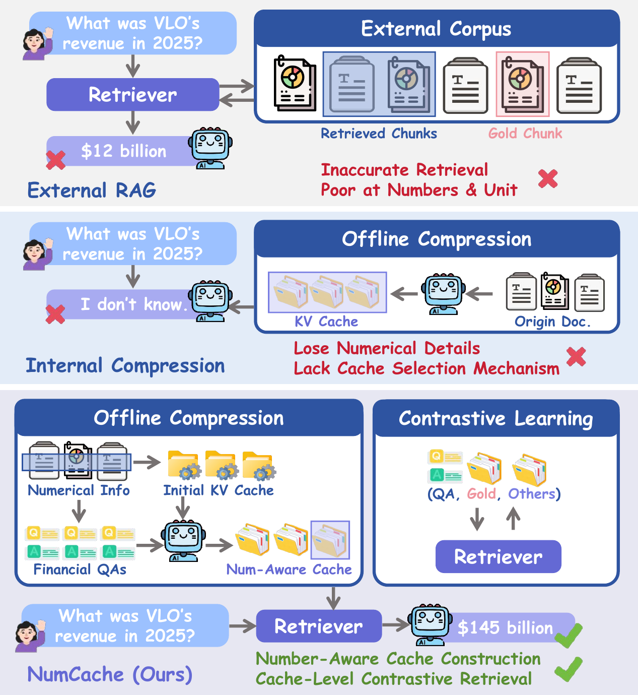
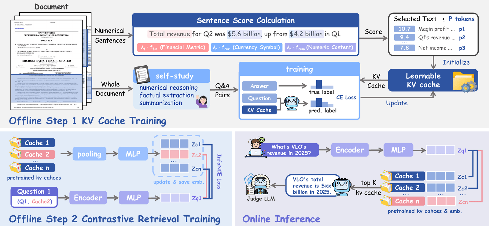
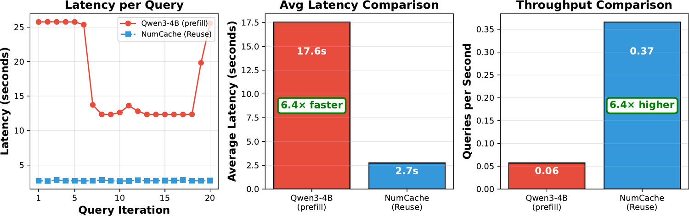

import { Authors, Badges } from '@/components/utils'

# NumCache: KV Cache Compression and Retrieval for Financial Document QA

<Authors
  authors="Eftychia Makri, Yale University; Peiwen Li, Yale University; Yidong Jiang, Tongji University; Junrong Chen, UC San Diego; Jialin Chen, Yale University; Ali Maatouk, Yale University; Leandros Tassiulas, Yale University; Eliot Brenner, Goldman Sachs; Bing Xiang, Goldman Sachs; Rex Ying, Yale University"
/>

<Badges
  venue="KDD 2026"
  github="https://github.com/eftymakr/NumCache"
  pdf="https://dl.acm.org/doi/pdf/10.1145/3770855.3818131"
/>

## TL;DR

A single SEC filing can run to hundreds of thousands of tokens, and the answer to an analyst's question usually turns on an exact figure buried somewhere inside it. **NumCache** compresses each filing into a trainable KV cache that is built around its numbers, then retrieves over those caches directly - so retrieval and generation share the same representation.

At 4× compression NumCache keeps **92% of full-context accuracy** on single-filing reasoning, runs **6.4× faster** per query, and its contrastive retriever reaches **68.3% Recall@1**, 2.3× the strongest text-based baseline.

## Why this matters

Financial QA over SEC filings breaks the usual long-document toolkit in a specific way: the documents are long *and* numerically dense, and precision matters more than topicality.



- **External RAG** retrieves passages by semantic similarity. Dense embeddings collapse fine-grained magnitudes and units, so a retriever will happily return a passage about revenue that contains the wrong revenue.
- **Internal compression (CAG)** trains compact KV caches offline and reuses them as internal memory. But caches are typically distilled from a teacher's softened output distribution, which barely separates \$4.2B from \$5.6B - exactly the distinctions that decide the answer.
- **Cache selection** is largely unaddressed. Prior cache methods assume the right cache is already in hand, leaving open how to pick one per query.

NumCache attacks all three: build caches that preserve numbers, train them on the right objective, and retrieve among them in cache space.

## Method



The pipeline has two offline stages and one online stage.

### 1. Number-preserving cache initialization

Rather than seeding the cache with the first *p* tokens of a filing - which, in a 10-K, is mostly front matter - NumCache scores every sentence for numerical salience and greedily fills the token budget with the highest scorers:

$$
\mathrm{score}(s)=\sum_{k \in K(s)} w_k + \alpha\,|\mathrm{numbers}(s)| + \beta \cdot \mathbb{1}[\$ \in s] + \gamma \sum_{n} \log_{10} \max(\mathrm{value}(n),1)
$$

with α = 2 (numeric density), β = 5 (currency salience), γ = 1/3 (magnitude), and budget *p* = *T*/4. Leftover budget goes to neighbouring context, and selected sentences are restored to reading order.

At the same 4× budget, this keeps **67.3%** of a filing's numerical sentences against **6.2%** for first-*p* initialization - and that gap carries straight through to accuracy (6.2% → 13.79% DR-QA).

| Initialization (4× budget) | Numerical sentences | Financial keywords |
| -------------------------- | ------------------- | ------------------ |
| First-*p* tokens           | 6.2%                | 12                 |
| Random sampling            | 18.4%               | 34                 |
| **Number-preserving (ours)** | **67.3%**         | **89**             |

### 2. Cache training on number-focused QAs

The cache is then trained with **token-level cross-entropy on gold answers**, not by matching a teacher distribution - the signal has to force the exact token. Supervision comes from 155,084 QA pairs generated offline and LLM-judge filtered, roughly one pair per 40 source tokens, each naming the company and reporting period. The mix is 50% factual extraction, 40% synthesis, 10% numerical reasoning. Gradients reach only the key and value vectors; the base model stays frozen.

### 3. Query-adaptive contrastive cache retrieval

Cache vectors are read straight off the stored keys - mean-pool over tokens, flatten heads, one vector per layer - so they are computed offline with no re-encoding of the document. A query-adaptive gate weights the last *L* = 4 layers per question, and dual projection heads align questions and caches in a shared space under a bidirectional InfoNCE loss:

$$
\mathcal{L}_{NCE} = -\frac{1}{B} \sum_{i=1}^{B} \log \frac{\exp(s(q_i,c_i^{+}))}{\sum_{j=1}^{B} \exp(s(q_i,c_j))}, \qquad s(q,c) = \frac{z_q^{\top} z_c}{\tau}
$$

with in-batch negatives and τ = 0.05. Only the two heads and the layer gate are trained.

## Results

We evaluate on [Fin-RATE](/projects/finrate), which covers three analyst task types: **DR-QA** (detail and reasoning within one filing), **EC-QA** (cross-firm comparison), and **LT-QA** (longitudinal tracking across years).

### Retrieval in KV-cache space

Retrieving over pooled cache vectors more than doubles single-filing Recall@1 over the strongest text retriever. Cross-firm and longitudinal retrieval remain hard for every method, including ours.

| Method | DR R@1 | DR R@10 | EC R@5 | LT R@1 |
| ------ | ------ | ------- | ------ | ------ |
| BM25 | 22.1 | 56.6 | 11.3 | 15.0 |
| BM25 + Reranker | 29.7 | 61.4 | 10.5 | 10.1 |
| NumBM25 | 26.2 | 58.6 | 11.8 | 20.0 |
| Elasticsearch | 8.3 | 32.4 | 8.4 | 8.0 |
| Elasticsearch + Reranker | 22.8 | 43.4 | 9.4 | 8.9 |
| Vector (MiniLM) | 19.3 | 44.1 | 5.2 | 2.6 |
| Vector (MiniLM) + Reranker | 24.1 | 46.2 | 3.3 | 6.5 |
| Vector (FinLang) | 11.7 | 38.6 | 13.8 | 1.2 |
| Vector (FinLang) + Reranker | 22.1 | 42.8 | 9.7 | 5.1 |
| **NumCache (ours)** | **68.3** | **87.6** | **15.8** | **20.8** |

### End-to-end QA

Reading only a 4× compressed cache, NumCache retains 92% of full-context single-filing accuracy and beats every Qwen3-4B RAG baseline at *k* = 1.

| Method (LLM-as-Judge correctness %) | DR-QA | EC-QA | LT-QA |
| ----------------------------------- | ----- | ----- | ----- |
| Qwen3-4B, full context | 44.8 | 0.0 | 18.6 |
| Qwen3-4B + BM25 | 20.0 | 5.3 | 15.5 |
| Qwen3-4B + BM25 + Reranker | 28.3 | 5.3 | 9.3 |
| Qwen3-4B + NumBM25 | 29.7 | 5.3 | 12.4 |
| Qwen3-4B + Vector (FinLang) + Reranker | 25.2 | 5.3 | 6.2 |
| **NumCache, full context (4×)** | **41.4** | **5.3** | **7.3** |
| **NumCache + contrastive retrieval** | **32.4** | **10.5** | **4.1** |

DR-QA uses *k* = 1, so a single cache is loaded and no composition is needed. EC-QA and LT-QA use *k* = 5, composed at the **answer level**: each retrieved cache is injected on its own, answered in isolation, and a final answer is synthesized from the *k* candidates. Concatenating caches in KV space instead collapses to 0.0 / 1.0 - the cross-document deficit is a composition artifact, not information loss.

### Inference efficiency

Document encoding happens once, at cache construction, and is amortized across every later query. Over 20 questions on one filing section, per-query latency drops from 17.6 s to 2.7 s.



Compression sweep on a 34,230-token chunk: 4× matches 2× exactly (21.9% accuracy on both), while 8× collapses to 10.9% - so 4× sits right at the usable edge.

## Takeaway

NumCache shows that for numerically dense documents, *what you keep* under compression matters as much as how much you keep - and that once caches are number-faithful, they are good enough to retrieve over directly, letting retrieval and generation share one representation instead of two.

The remaining gap is informative: 68.3% Recall@1 against 32.4% end-to-end correctness on DR-QA says retrieval is no longer the bottleneck. Richer cache representations or a larger base model are where the next gains are.

---

## Citation

```bibtex
@inproceedings{makri2026numcache,
  title={NumCache: KV Cache Compression and Retrieval for Financial Document QA},
  author={Makri, Eftychia and Li, Peiwen and Jiang, Yidong and Chen, Junrong and Chen, Jialin and Maatouk, Ali and Tassiulas, Leandros and Brenner, Eliot and Xiang, Bing and Ying, Rex},
  booktitle={Proceedings of the 32nd ACM SIGKDD Conference on Knowledge Discovery and Data Mining V.2 (KDD '26)},
  pages={3655--3666},
  year={2026},
  publisher={ACM},
  doi={10.1145/3770855.3818131}
}
```
