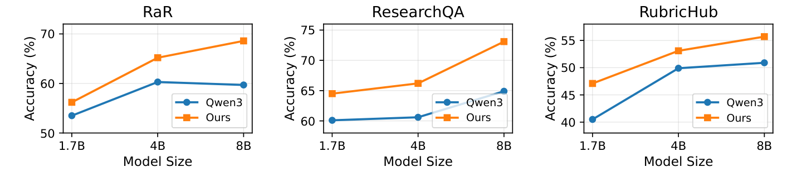

import { Authors, Badges } from '@/components/utils'

# Rethinking Reward Supervision: Rubric-Conditioned Self-Distillation

<Authors
  authors="Siyi Gu, Yale University; Jialin Chen, Yale University; Sophia Zhou, Yale University; Arman Cohan, Yale University; Rex Ying, Yale University"
/>


<Badges
  venue="COLM 2026"
  github="https://github.com/carriegu0818/RCSD"
  arxiv="https://arxiv.org/abs/2606.19327"
  pdf="https://arxiv.org/pdf/2606.19327"
/>

## TL;DR

Post-training reasoning models usually means one of two things: reinforcement learning with a verifiable reward, or distillation from a reference solution. Both throw away information. A scalar reward tells the model that an answer was wrong, but not *which step* was wrong. A reference rationale tells the model *one* way to solve the problem, even when several are valid.

We propose **Rubric-Conditioned Self-Distillation (RCSD)**, which uses **rubrics as privileged, teacher-side supervision** for on-policy self-distillation. The teacher reads a question-specific rubric, the student does not, and the student is trained to match the teacher token by token along its *own* sampled answers. At inference, no rubric is needed.

## Why this matters

Two problems show up whenever we try to supervise reasoning:

- **One question, many valid paths.** Open-ended questions have many good answers, and even exact-answer problems admit several derivations. A single reference answer, as used by on-policy self-distillation (OPSD), can over-specify one solution path and push the student to revise correct steps that simply differ from the reference.
- **Answers fail at different steps.** Two answers to the same physics problem can both score 0 while making entirely different mistakes (one skips an efficiency factor, the other gets the units wrong). GRPO, even with rubric-aggregated rewards, hands both the same scalar signal.

Rubrics address both. They describe *what* a strong response must satisfy (essential steps, important details, common pitfalls) rather than *how* it must be written, so they can discriminate between valid paths and localize errors at the same time.


## The core idea

In on-policy self-distillation, a single base model plays two roles. The **student** sees only the question $x$ and samples an answer $\hat{y} \sim p_S(\cdot \mid x)$. The **teacher**, whose weights stay fixed, sees privileged information the student does not, and the student is trained to match the teacher's next-token distribution at every prefix of its own rollout.

Prior work conditions the teacher on a reference answer $y^\star$. RCSD conditions it on a **rubric** $r$ instead: a structured set of question-specific criteria, each with a title, a natural-language description, and an importance level (Essential, Important, Optional, or Pitfall).

$$
\mathcal{L}_{\text{reason}} = \mathbb{E}_{\hat{y} \sim p_S(\cdot \mid x)} \left[ \sum_{t=1}^{|\hat{y}|} D_{\mathrm{KL}}\!\left( p_T(\cdot \mid x, r, \hat{y}_{<t}) \,\|\, p_S(\cdot \mid x, \hat{y}_{<t}) \right) \right]
$$

The resulting training signal is simultaneously **criterion-aware** (it keeps the distinctions between evaluation dimensions), **on-policy** (it is computed on student-generated rollouts, not fixed off-policy traces), and **token-level** (it is dense, not a single number at the end of the sequence). No separate reward model or LLM judge is needed during distillation.


## How it works: a two-stage pipeline

High-quality instance-specific rubrics are expensive, so RCSD amortizes them.

**Stage I: learn a rubric generator.** A rubric-generation student sees only the question; its teacher additionally sees a reference answer. The student is trained by on-policy self-distillation to produce question-specific rubrics without privileged inputs. We train it on roughly 10k examples drawn from RaR-Science and RubricHub.

**Stage II: train a rubric-conditioned reasoner.** For each training question, the Stage I generator produces a rubric. The reasoning student samples an answer from the question alone; the teacher reads the question plus the rubric and provides token-level guidance on that answer. We train on roughly 30k reasoning examples with LoRA.

At inference time the trained reasoner takes a question and produces an answer. The rubric generator and the teacher are only used during training.

## Why forward KL

Rubrics specify the criteria a correct solution must satisfy, which induces a teacher distribution over *many* valid reasoning paths rather than a single reference path. Forward KL, $D_{\mathrm{KL}}(p_T \,\|\, p_S)$, asks the student to cover the support of that distribution, preserving probability mass on alternative derivations that satisfy the same criteria. More mode-seeking objectives collapse onto dominant teacher modes. Empirically, forward KL gives the best average (70.6 vs. 69.9 for reverse KL and 69.6 for JSD) and is the only objective under which student entropy rises steadily during training rather than shrinking.

## Results

We evaluate on six science reasoning benchmarks with a Qwen3-8B backbone: three verifiable (GPQA-Diamond, SciBench, PIQA) and three rubric-based or open-ended (RaR-Science, ResearchQA, RubricHub). All self-distillation methods are trained for 100 steps; GRPO is trained for 500.

<table className="table-auto border-collapse border border-gray-300 dark:border-gray-600 w-full text-sm">
  <thead>
    <tr>
      <th className="border border-gray-300 dark:border-gray-600 px-4 py-2 bg-gray-100 dark:bg-gray-800 text-left">Method</th>
      <th className="border border-gray-300 dark:border-gray-600 px-4 py-2 bg-gray-100 dark:bg-gray-800 text-left">GPQA-D</th>
      <th className="border border-gray-300 dark:border-gray-600 px-4 py-2 bg-gray-100 dark:bg-gray-800 text-left">SciBench</th>
      <th className="border border-gray-300 dark:border-gray-600 px-4 py-2 bg-gray-100 dark:bg-gray-800 text-left">PIQA</th>
      <th className="border border-gray-300 dark:border-gray-600 px-4 py-2 bg-gray-100 dark:bg-gray-800 text-left">RaR</th>
      <th className="border border-gray-300 dark:border-gray-600 px-4 py-2 bg-gray-100 dark:bg-gray-800 text-left">ResearchQA</th>
      <th className="border border-gray-300 dark:border-gray-600 px-4 py-2 bg-gray-100 dark:bg-gray-800 text-left">RubricHub</th>
      <th className="border border-gray-300 dark:border-gray-600 px-4 py-2 bg-gray-100 dark:bg-gray-800 text-left">Avg</th>
    </tr>
  </thead>
  <tbody>
    <tr>
      <td className="border border-gray-300 dark:border-gray-600 px-4 py-2">Qwen3-8B</td>
      <td className="border border-gray-300 dark:border-gray-600 px-4 py-2">60.6</td>
      <td className="border border-gray-300 dark:border-gray-600 px-4 py-2">69.1</td>
      <td className="border border-gray-300 dark:border-gray-600 px-4 py-2">90.2</td>
      <td className="border border-gray-300 dark:border-gray-600 px-4 py-2">59.7</td>
      <td className="border border-gray-300 dark:border-gray-600 px-4 py-2">64.9</td>
      <td className="border border-gray-300 dark:border-gray-600 px-4 py-2">50.8</td>
      <td className="border border-gray-300 dark:border-gray-600 px-4 py-2">65.9</td>
    </tr>
    <tr>
      <td className="border border-gray-300 dark:border-gray-600 px-4 py-2">+ SFT</td>
      <td className="border border-gray-300 dark:border-gray-600 px-4 py-2">62.0</td>
      <td className="border border-gray-300 dark:border-gray-600 px-4 py-2">65.4</td>
      <td className="border border-gray-300 dark:border-gray-600 px-4 py-2">89.2</td>
      <td className="border border-gray-300 dark:border-gray-600 px-4 py-2">61.5</td>
      <td className="border border-gray-300 dark:border-gray-600 px-4 py-2">63.2</td>
      <td className="border border-gray-300 dark:border-gray-600 px-4 py-2">51.2</td>
      <td className="border border-gray-300 dark:border-gray-600 px-4 py-2">65.4</td>
    </tr>
    <tr>
      <td className="border border-gray-300 dark:border-gray-600 px-4 py-2">+ GRPO</td>
      <td className="border border-gray-300 dark:border-gray-600 px-4 py-2">63.5</td>
      <td className="border border-gray-300 dark:border-gray-600 px-4 py-2">69.7</td>
      <td className="border border-gray-300 dark:border-gray-600 px-4 py-2">90.3</td>
      <td className="border border-gray-300 dark:border-gray-600 px-4 py-2">68.2</td>
      <td className="border border-gray-300 dark:border-gray-600 px-4 py-2">71.5</td>
      <td className="border border-gray-300 dark:border-gray-600 px-4 py-2">51.9</td>
      <td className="border border-gray-300 dark:border-gray-600 px-4 py-2">69.2</td>
    </tr>
    <tr>
      <td className="border border-gray-300 dark:border-gray-600 px-4 py-2">+ GRPO-Rubrics</td>
      <td className="border border-gray-300 dark:border-gray-600 px-4 py-2">62.1</td>
      <td className="border border-gray-300 dark:border-gray-600 px-4 py-2">70.2</td>
      <td className="border border-gray-300 dark:border-gray-600 px-4 py-2">90.3</td>
      <td className="border border-gray-300 dark:border-gray-600 px-4 py-2"><strong>69.9</strong></td>
      <td className="border border-gray-300 dark:border-gray-600 px-4 py-2">72.1</td>
      <td className="border border-gray-300 dark:border-gray-600 px-4 py-2">52.9</td>
      <td className="border border-gray-300 dark:border-gray-600 px-4 py-2">69.6</td>
    </tr>
    <tr>
      <td className="border border-gray-300 dark:border-gray-600 px-4 py-2">+ OPSD</td>
      <td className="border border-gray-300 dark:border-gray-600 px-4 py-2">63.6</td>
      <td className="border border-gray-300 dark:border-gray-600 px-4 py-2">68.7</td>
      <td className="border border-gray-300 dark:border-gray-600 px-4 py-2">90.1</td>
      <td className="border border-gray-300 dark:border-gray-600 px-4 py-2">68.5</td>
      <td className="border border-gray-300 dark:border-gray-600 px-4 py-2">72.8</td>
      <td className="border border-gray-300 dark:border-gray-600 px-4 py-2">54.5</td>
      <td className="border border-gray-300 dark:border-gray-600 px-4 py-2">69.7</td>
    </tr>
    <tr>
      <td className="border border-gray-300 dark:border-gray-600 px-4 py-2"><strong>+ RCSD (Ours)</strong></td>
      <td className="border border-gray-300 dark:border-gray-600 px-4 py-2"><strong>64.5</strong></td>
      <td className="border border-gray-300 dark:border-gray-600 px-4 py-2"><strong>70.8</strong></td>
      <td className="border border-gray-300 dark:border-gray-600 px-4 py-2"><strong>90.8</strong></td>
      <td className="border border-gray-300 dark:border-gray-600 px-4 py-2">68.6</td>
      <td className="border border-gray-300 dark:border-gray-600 px-4 py-2"><strong>73.1</strong></td>
      <td className="border border-gray-300 dark:border-gray-600 px-4 py-2"><strong>55.7</strong></td>
      <td className="border border-gray-300 dark:border-gray-600 px-4 py-2"><strong>70.6</strong></td>
    </tr>
  </tbody>
</table>

RCSD has the best average and leads on five of six benchmarks, improving over the base model by 4.7 points and over OPSD, the strongest baseline, by 0.9 points. The gains are largest where scalar outcome rewards are least informative: +8.2 on ResearchQA and +4.9 on RubricHub over the base model.

**Gains hold across model scales.** RCSD improves over the corresponding Qwen3 base model at 1.7B, 4B, and 8B on all three rubric-based benchmarks.



**Learned rubrics are nearly as good as reference rubrics.** Conditioning the teacher on rubrics from the Stage I generator costs only 0.2 to 0.7 points relative to ground-truth rubrics, and a learned 8B generator beats prompting the 8B base model for rubrics directly (70.6 vs. 69.9), nearly matching rubrics from a 14B model (70.7).

**RCSD is robust to rubric quality, but relevance still matters.** Generic, random, noisy, and halved rubrics all still improve over the base model (69.9 to 70.2 average), suggesting the teacher can partially correct unreasonable criteria. The full learned rubric remains the best (70.6), and concise but relevant criteria preserve most of the benefit.

**No forgetting on adjacent domains.** Trained only on science reasoning, RCSD still improves over the base model on MedMCQA (64.5 to 65.8) and PubMedQA (74.2 to 75.1).

## Takeaway

Rubrics should not only score responses after generation; they should shape token-level learning during optimization. RCSD turns rubrics into a **structured supervision interface** for self-improvement: Stage I learns *what* a strong response should satisfy, and Stage II learns *how* to realize those criteria along the student's own trajectory. The result is a verifier-free recipe for post-training open-ended reasoning models, where quality cannot be captured by exact-match answers, unit tests, or a single scalar reward.


---

## Citation

```bibtex
@article{gu2026rethinking,
  title={Rethinking Reward Supervision: Rubric-Conditioned Self-Distillation},
  author={Gu, Siyi and Chen, Jialin and Zhou, Sophia and Cohan, Arman and Ying, Rex},
  journal={arXiv preprint arXiv:2606.19327},
  year={2026}
}
```
